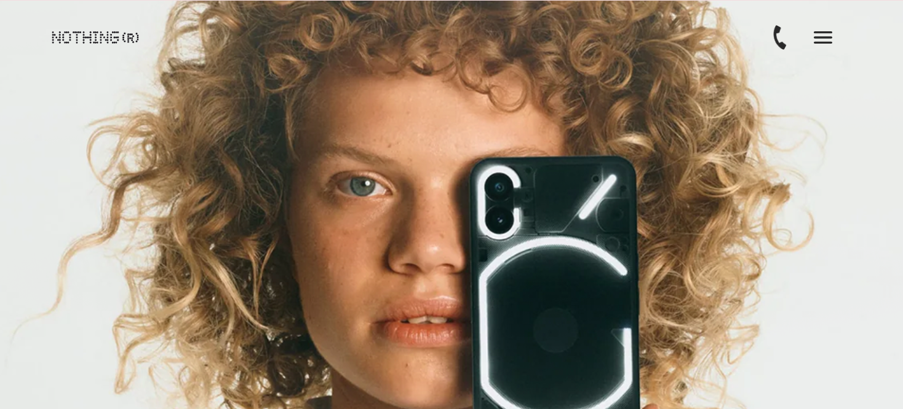

# Мінімалістичний односторінковий лендінг з адаптивною версткою (реалізований як навчальний проєкт)

  

🚀 Опис

Це навчальний проєкт, що демонструє базові навички роботи з сучасною версткою:

Адаптивний дизайн для різних розмірів екранів

Використання SCSS для структурування стилів

Мінімальний JavaScript для інтерактивності

Зручна структура файлів та компонентів

🛠️ Технології

HTML5

SCSS (SASS)

JavaScript (Vanilla JS)

Vite (для швидкої збірки, якщо використовується)

📱 Особливості

Повністю адаптивна верстка

Чиста структура коду

Використання методології BEM

Зрозумілий та легкий у підтримці код

💡 Мета

Проєкт створено для відпрацювання навичок верстки та побудови адаптивних лендінгів без використання сторонніх бібліотек.
